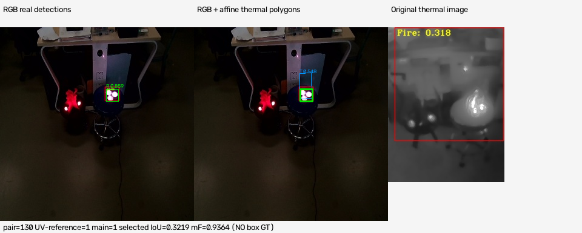
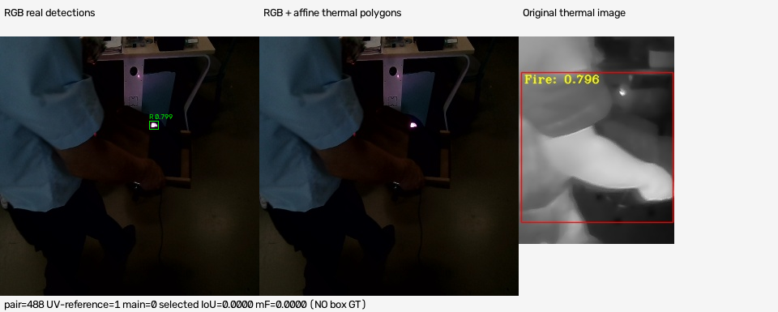
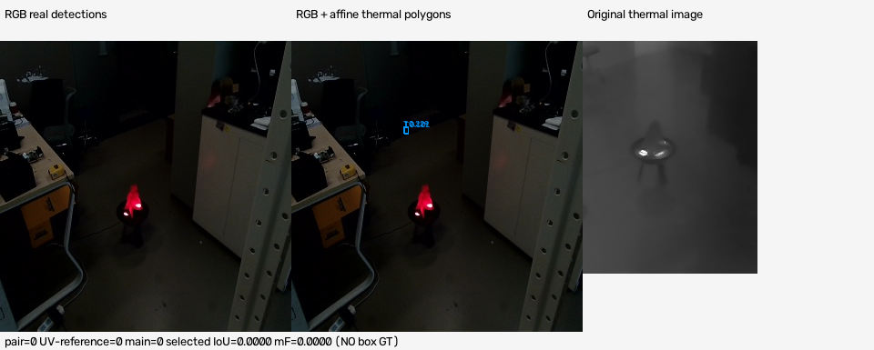

# 320输入下基于空间一致性门控与D-S正向证据组合的火情判别复核报告

## 摘要

为复核指定检查点在320输入下的帧级火情判别，本实验对1528组RGB—热成像配对样本重新执行完整GPU前向，使用既有七点全仿射变换及多边形IoU完成空间配对，在冻结阈值下组合正向火情简单支持证据。主方法不输入UV，第四列UV仅用作0/1参考标签。得到TP=1359、FP=0、FN=39、TN=130，FPR=0.0000%、FNR=2.7897%、F1=98.5854%。同次320前向的RGB与热成像score>0.5基线分别为FPR=51.5385%、8.4615%，FNR=14.5207%、36.6953%。结果为已见数据上的UV参考一致性复核，不能表述为独立泛化验证或动态可靠性折扣增益。

## 关键词

火情检测；RGB—热成像；全仿射配准；多边形IoU；Dempster–Shafer证据；误报率；漏报率

## 1 引言

不同模态在火情候选检出与干扰响应上存在差异。本文复核一个可重复的空间一致性门控及证据组合流程，重点给出误报率FPR与漏报率FNR，避免将假阳性率与1−精确率混淆。本文不重新训练、不更换权重、不启用ROI，也不以历史640结果替代同输入尺寸对照。由于阈值曾在已见配对数据上选取，本工作定位为受控复核而非新独立测试。

## 2 数据与模型

数据目录为C:/lyk/paper_data/paper_data_/paper_data，paper_sample.txt每行记录RGB文件、热成像文件、最高温度和UV参考值。共1528行、1398个UV=1与130个UV=0；两模态各1528个唯一源文件，重新读取并计算3056个唯一图像SHA256，无缺失或重复配对索引。原始RGB为320×320，热成像为256×192；原尺寸检测框用于几何映射，不在320字面尺寸下强行改坐标。最高温度不参与本次决策；UV不进入主方法。参考标签不是独立人工火情真值，更无目标框GT，因此只报告帧级指标，不报告AP/mAP。

## 2.1 指定权重与训练元数据

RGB直接加载C:/Users/Administrator/AppData/Local/hermes/attachments/best.pt；thermal直接加载同目录best-2.pt。二者均为Ultralytics YOLO26n，单类别class 0=fire/Fire，end2end=True，非PPYOLOv2。
RGB SHA256=1068cfddcca133ac2f6c66522d7a43f4988daa91023c1c8898bb6fbf4a894e32
thermal SHA256=c068422549d5de50d532431892a940a44ce2300b1cb0fae2e12887749adc12e6
检查点SHA与此前RGB5/thermal5原始320实验一致，不使用RGB6、thermal3或后续安全训练模型。保存的RGB训练参数name=fireOrigin_yolo26n-5、data=cfgs\bgr.yaml、epochs=100、imgsz=320；thermal为thermal_yolo26n-5、cfgs\thermal.yaml、epochs=10、imgsz=320。本次训练次数为零。完整检查点yaml和train_args存于model_metadata.json。

## 2.2 数据重叠审计

对当前TorchDetection源划分重新计算图像哈希：{"fireOrigin_train": {"images": 2376, "test_overlap": 298}, "fireOrigin_val": {"images": 595, "test_overlap": 74}, "thermal_train": {"images": 1959, "test_overlap": 74}, "thermal_val": {"images": 490, "test_overlap": 15}}。RGB训练/验证与测试分别重叠298/74张，thermal分别重叠74/15张。此为当前源数据内容与测试的确切重复，不足以独立证明历史检查点实际使用了每一张图，但结合保存data配置构成明确风险。不得声称train/val/test独立或无泄漏，也不得把后续去重训练结果混入本表。

## 3 方法：空间约束与正向证据组合

本次沿用calibrated_spatial_ds/frozen_selected.json中的冻结参数：RGB≥0.2、thermal≥0.1、IoU≥0.01、rmin=1、最终mF>0.3。先按候选置信度筛选，再匹配；缺失或不配对时mF=0、mN=0、mU=1。该二分类工作点将未满足火情条件的帧归为0，不保留弃权类别，不能把mN=0称为模型已证明无火。

## 3.1 七点全仿射与真实多边形IoU

采用thermal→RGB的FULL affine矩阵A=[[0.7113039166517691, 0.0044504657857417015, 78.2274089470037], [-0.045135242080470914, 0.963053329624529, -15.942804622066248]]。热框四个角均以pR=A[pT.x,pT.y,1]^T映射，生成四边形；IoU=交集面积/(RGB框面积+映射多边形面积−交集面积)，交集通过cv2.intersectConvexConvex实际计算，不取AABB、不加人工像素偏移、不使用投影框替代检测。七点RANSAC内点6/7；全点拟合RMSE=2.479927 px，内点RMSE=0.996947 px，留一法RMSE=5.771805 px、最大误差9.142144 px。留一法是点集诊断，不是跨场景配准验证；该变换尚无独立全视场/多场景验证。

## 3.2 一对一配对与候选选择

对已筛选真实检测构造IoU矩阵，以dummy节点扩充为(n+m)×(n+m)矩阵，真实边IoU≥0.01时权重为IoU，否则为−1，dummy边为0；Hungarian最大总IoU完成一对一配对。遍历合格匹配对，以最高融合火情质量mF作为唯一帧级候选，选择过程独立于UV。不跨多个相关框累积组合证据。0.01为宽松硬门限，不能被描述为高精度空间一致性的证明。

## 3.3 D-S公式与决策

识别框架Θ={F,N}，每个检测的名义BPA为m(F)=c、m(N)=0、m(Θ)=1−c。冻结rmin=1意味着r=1，空间IoU仅决定硬门控、不执行动态可靠性折扣。两个正向简单支持由Dempster规则组合：K=0；mF=1−(1−cR)(1−cT)，mN=0，mU=(1−cR)(1−cT)。两质量之和为1；该运算是OR型正向支持增强，不是冲突建模或校准后验。只有真实双模态匹配且mF>0.3时输出火情。使用mF而非BetP；阈值严格大于，候选与IoU门限含等号。

## 3.4 UV仅作为可选循环消融

单独记录mF_uv=mF×[0.5+0.5×UV]，仍以mF_uv>0.3判断。这是D-S之后的乘性门控，不是额外空间证据，UV没有图像位置。由于UV同时充当参考标签，此消融具有循环评价风险，不作为主结果或独立提升证据。本次消融与主方法全部1528帧判决相同，不能宣称UV改善性能。

## 4 实验协议与评价定义

在任何smoke/full前向之前保存frozen_protocol.json及SHA回执。先真实3组样本smoke（6图），随后两模态各1528图完整前向，共3056图；设备cuda:0，NVIDIA GeForce RTX 5070，Torch 2.13.0+cu132、Ultralytics 8.4.60。输入OpenCV BGR数组，batch=32、rect=False、固定imgsz=320；forward hook验证实际张量H=W=320，逐结果验证orig_img与源数组逐像素一致，并显式绑定源路径、pair_index与哈希，规避Ultralytics批路径丢失。half=False、augment=False、classes=[0]、max_det=300、iou参数0.7。YOLO26n端到端Nx6路径跳过常规NMS，因此0.7不作为实际NMS抑制阈值的作用依据。

## 4.1 与上次320协议的边界差异

上次原始320完整前向使用conf=0.01；本次按本轮要求使用conf=0.05，Ultralytics实际保留边界为score>0.05。后续操作门限仍为RGB≥0.2与thermal≥0.1，均高于新旧候选地板。这不是把旧0.01原始框缓存伪装为新前向，也不声称低分原始框列表逐位相同。本次实际新前向复现主方法1359/0/39/130计数。未执行ROI；协议、代码与来源哈希保存在独立新目录，旧结果未覆盖。

## 4.2 指标定义

以UV=1为参考阳性，TP为参考阳性且预测火情；FP为参考阴性但预测火情；FN为参考阳性但预测0；TN为参考阴性且预测0。Accuracy=(TP+TN)/1528，Precision=TP/(TP+FP)，Recall=TP/(TP+FN)，F1=2TP/(2TP+FP+FN)，FPR=FP/(FP+TN)=FP/130，FNR=FN/(FN+TP)=FN/1398。FPR不是FP/(TP+FP)。所有方法使用同一1528行同一次320预测。主单模态对照以任一真实框score>0.5判断；操作候选阈值RGB≥0.2与thermal≥0.1作为辅助对照完整披露，不挑选有利阈值。

## 5 结果与讨论

表1给出同次320输入的完整帧级结果。百分数保留四位小数，原始未舍入数值见metrics.json；TP/FP/FN/TN均为整数实测计数。

| 方法 | TP | FP | FN | TN | 准确率 | 精确率 | 召回率 | F1 | FPR | FNR |
| --- | --- | --- | --- | --- | --- | --- | --- | --- | --- | --- |
| RGB单模态，score>0.5 | 1195 | 67 | 203 | 63 | 82.3298% | 94.6910% | 85.4793% | 89.8496% | 51.5385% | 14.5207% |
| 热成像单模态，score>0.5 | 885 | 11 | 513 | 119 | 65.7068% | 98.7723% | 63.3047% | 77.1578% | 8.4615% | 36.6953% |
| RGB辅助阈值，score≥0.2 | 1362 | 70 | 36 | 60 | 93.0628% | 95.1117% | 97.4249% | 96.2544% | 53.8462% | 2.5751% |
| 热成像辅助阈值，score≥0.1 | 1392 | 130 | 6 | 0 | 91.0995% | 91.4586% | 99.5708% | 95.3425% | 100.0000% | 0.4292% |
| 空间IoU门控+D-S（主方法，无UV） | 1359 | 0 | 39 | 130 | 97.4476% | 100.0000% | 97.2103% | 98.5854% | 0.0000% | 2.7897% |
| D-S后UV乘性门控（循环消融） | 1359 | 0 | 39 | 130 | 97.4476% | 100.0000% | 97.2103% | 98.5854% | 0.0000% | 2.7897% |

## 5.1 相对同尺寸单模态基线

主方法相对RGB>0.5基线，FPR降低51.5385个百分点，FNR降低11.7310个百分点；相对thermal>0.5基线，FPR降低8.4615个百分点，FNR降低33.9056个百分点。本次thermal>0.5并非零误报/零漏报，实际FP=11、FN=513；不存在用旧640替代320基线的问题。该对照共同改变了单模态置信度工作点、真实双模态约束与组合规则，不能将全部提升单独归因于D-S或空间配准。

## 5.2 辅助操作阈值与覆盖约束

RGB≥0.2辅助基线TP=1362、FP=70、FN=36；主方法漏报39，比该RGB工作点增加3个，换取减少70个假阳性。thermal≥0.1辅助基线TP=1392、FP=130、FN=6，提示低候选地板检出更多火情但也响应全部130个参考阴性。主方法不是对所有工作点都同时更优，不应作无条件优势论断。
候选与几何覆盖：{"rgb_raw_boxes": 2054, "thermal_raw_boxes": 5005, "rgb_operating_boxes": 1939, "thermal_operating_boxes": 3929, "no_rgb_candidates": 96, "no_thermal_candidates": 6, "no_eligible_match": 169, "positive_no_eligible_match": 39, "matched_pairs": 1855, "selected_iou_quantiles": {"min": 0.2066873136816356, "q25": 0.4264707453672858, "median": 0.48387415017880403, "q75": 0.5701887644290465, "max": 0.7051060991861787}}。合格匹配帧1359，无合格匹配169，其中UV阳性39、阴性130；主方法39个漏报全部来自双模态候选/几何门控失败，所有合格匹配帧均通过最终质量阈值。selected IoU是每帧选定最高mF匹配的IoU，不是全体框的最大IoU。

## 5.3 零误报的不确定性与限制

主方法在130个UV参考阴性上FP=0，观察FPR=0%。二项独立假设下Clopper–Pearson双侧95%区间为[0,2.7977%]，不保证部署真实误报为零。数据带时间关联且类别不均衡，该区间只是条件性数值示例，不解决独立性问题。
模型置信度未经校准；冻结配置源自此前已见1528配对数据的搜索；源训练/验证存在精确内容重叠；UV参考未获独立人工火情复核；配准缺少跨场景验证；没有目标级GT、跨场景外部集或单独空间/D-S因果消融。本结果仅支持这些模型与既有参数在该参考集上的受控复核。

## 5.4 真实检测可视化

图1—图3依次展示正确检出、参考阳性漏报和参考阴性示例。绿色为RGB模型真实框，蓝色为thermal真实检测经全仿射变换后的四边形，右侧为原始热图；图中列出真实选定IoU与mF，不画伪造GT。漏报/未匹配时selected IoU=0与mF=0是未选定状态，不代表已绘制全部候选间IoU都为零。

## 5.5 执行与可复现记录

本次始于2026-10-14T06:52:33.433466+00:00、完成于2026-10-14T06:52:46.231539+00:00；总执行时间12.798 s，RGB完整前向与读取记录5.434 s，thermal为4.439 s。计时含批预测、图像读取、哈希和记录处理，不是纯GPU kernel延时，不直接推导部署FPS。保存真实逐批时钟、模型输入shape与逐图speed。验证器重新读源标签、图像哈希、候选几何与融合，逐行重算混淆矩阵，Word包CRC和文档结构另行校验。

## 6 结论

新完整320前向确认：指定RGB/thermal权重与冻结空间门控+D-S规则在1528组UV参考样本上得到FPR=0.0000%、FNR=2.7897%、准确率=97.4476%、精确率=100.0000%、召回率=97.2103%、F1=98.5854%。相对同次score>0.5单模态基线达到更低观察FPR和FNR。该结论限定于已见数据上的复核；不是独立测试、不是动态折扣算法验证，也不构成零误报部署保证。后续需另行建立时序/场景隔离的外部标签集、验证几何并在独立校准数据上固定阈值。

## 附录A 可复现工件

目录：C:\lyk\fire\qualityDetection\fusion\supplied320_paper_experiment。主要文件：infer320.py、fuse320.py、test_320.py、frozen_protocol.json、freeze_receipt.json、model_metadata.json、smoke_3pairs.json、forward.log、rgb_predictions.json、thermal_predictions.json、frame_predictions.csv、matched_evidence.json、metrics.json、coverage_diagnostics.json、source_overlap_audit.json、execution.json、examples/、validation.json及artifact_sha256.json。无需从旧结果抄写任何本次指标。
